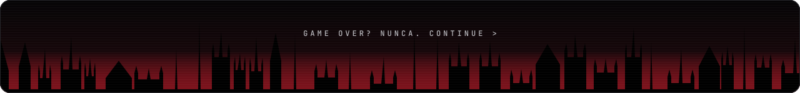

_ transformando prompts, código e física em coisas que funcionam" />

## 

  

## 

  

  

◆ **IA E DADOS** 
<kbd>Engenharia de prompts</kbd> <kbd>Avaliação de LLMs</kbd> <kbd>Alinhamento</kbd> <kbd>Anotação de dados</kbd> <kbd>Análise de vieses</kbd>

◆ **IA LOCAL E PRIVACIDADE** 
<kbd>LM Studio</kbd> <kbd>Modelos em hardware próprio</kbd> <kbd>SQLite</kbd> <kbd>Dados sob controle</kbd>

◆ **DESENVOLVIMENTO** 
<kbd>Python</kbd> <kbd>PySide6</kbd> <kbd>JavaScript</kbd> <kbd>TypeScript</kbd> <kbd>React</kbd> <kbd>Electron</kbd> <kbd>HTML</kbd> <kbd>CSS</kbd> <kbd>C</kbd> <kbd>C++</kbd>

◆ **FERRAMENTAS** 
<kbd>Git</kbd> <kbd>GitHub</kbd> <kbd>Linux CLI</kbd>

◆ **EM TREINAMENTO** 
<kbd>Machine learning</kbd> <kbd>Cibersegurança</kbd> <kbd>IA + ciências físicas</kbd>

## 

  

| Missão | Briefing |
| :--- | :--- |
| ◆ **[Betelgeuse A.I.](https://github.com/luizasenacafe/Aurora_AI)** | Aplicação desktop de IA local e privada: conecta modelos baixados no LM Studio e roda tudo no próprio computador ou em um servidor próprio, com prompts e conversas sob o controle de quem usa. |
| ◆ **[Random Animes](https://luizasenacafe.github.io/random_animes/)** | Aplicação web para descobrir animes e mangás, com filtros por gênero e modos de navegação separados. |
| ◆ **[Portfólio](https://luizasenacafe.github.io/)** | Meu quartel-general: projetos, experiência, formação e conteúdo em um só lugar. |

## 

  

<em>Construir sistemas, entender inteligência artificial e investigar o mundo físico.</em>

◆ **Ciência da Computação**  UNINTER · em andamento, conclusão prevista em 2030

◆ **Inteligência Artificial e Aprendizado de Máquina**  UNIASSELVI · em andamento, conclusão prevista no 1º semestre de 2029

◆ **Física (Licenciatura)**  Unicesumar · em andamento, conclusão prevista no 2º semestre de 2030

<strong>📜 Experiência e certificações</strong>

### Experiência

- **Outlier AI · Engenheira de Prompts** — desde abril de 2026. Criação, teste e avaliação de prompts, revisão de respostas e documentação de critérios de avaliação.
- **RWS Group · Analista de Dados e Treinadora de IA** — 2025–2026. Anotação de dados, avaliação de qualidade e possíveis vieses, além de feedback para treinamento de modelos.
- **Desenvolvimento web freelancer** — 2024–2025. Planejamento, desenvolvimento e publicação de um site profissional responsivo para uma profissional de Psicologia.

### Formação complementar

- **AI Specialist · Santander Digital Immersion** — Alura, FIAP, PM3 e StartSe · 107 horas.
- **Introdução à Cibersegurança** — Cisco Networking Academy.
- **Python: Programação Orientada a Objetos para Iniciantes** — UNINTER · 20 horas.
- **Letramento Digital: Introdução Profissional** — SENAI-MG · 40 horas.

**Idiomas:** português nativo · inglês intermediário · espanhol básico.

## 

  

## 

Cada contribuição, um inimigo a menos. Meu histórico em modo Galaga.

<picture>
  <source media="(prefers-color-scheme: dark)" srcset="https://raw.githubusercontent.com/luizasenacafe/luizasenacafe/pacman-output/galaga-contribution-graph-dark.svg">
  <source media="(prefers-color-scheme: light)" srcset="https://raw.githubusercontent.com/luizasenacafe/luizasenacafe/pacman-output/galaga-contribution-graph.svg">
  
</picture>

## 

<em>IA, ciência, desenvolvimento ou uma boa recomendação de anime.</em>

<a href="https://www.linkedin.com/in/luiza-sena-5645913a7/">LinkedIn</a> ·
<a href="https://luizasenacafe.github.io/">Portfólio</a> ·
<a href="mailto:luiizan12@gmail.com">E-mail</a> ·
<a href="https://www.instagram.com/luiizafk/">Instagram</a> ·
<a href="https://www.youtube.com/@shinnnji22">YouTube</a>

Discord: <code>karlpuccinomarx</code>

Créditos

Banners, títulos e painel de status criados para este perfil. Fontes das artes: Pirata One, Oswald, Cormorant Garamond e JetBrains Mono (SIL Open Font License). Ícones de tecnologia: [Skill Icons](https://skillicons.dev/). Badges: [Shields.io](https://shields.io/). Arcade: [pacman-contribution-graph](https://github.com/abozanona/pacman-contribution-graph).

